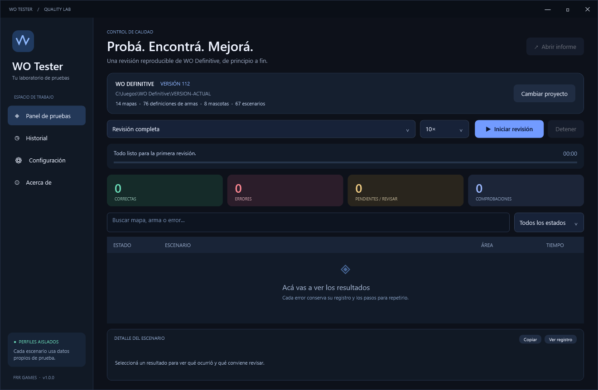

<p align="center"></p>

<h1 align="center">WO Tester</h1>
<p align="center">Un laboratorio independiente de pruebas para <strong>WO Definitive</strong>.</p>
<p align="center">Windows · Godot 4 · Informes reproducibles · FRR Games</p>



WO Tester descubre los datos y escenarios del juego, ejecuta pruebas con perfiles aislados y entrega evidencia de errores, bloqueos y cobertura pendiente. Se descarga y actualiza por separado de WO Definitive.

## Empezar

1. Descargá **WO-Tester-Windows.zip** desde [Releases](https://github.com/FedericoViceconte/WO-Tester/releases/latest).
2. Extraelo y abrí **WO Tester.exe**.
3. En **Configuración**, elegí la carpeta editable del juego (VERSION-ACTUAL) y el ejecutable de consola de la misma versión de Godot.
4. Guardá y elegí **Iniciar revisión**. Las siguientes aperturas pueden iniciar una revisión completa automáticamente.

Requisitos: Windows 10/11 con .NET Framework 4.8, el proyecto editable de WO Definitive importado en Godot y su motor correspondiente. El tester no incluye el juego, Godot, credenciales ni servicios de Epic. Una descarga del juego que contiene solamente el EXE/PCK no ofrece la misma cobertura y no se acepta como proyecto editable en esta versión.

## Qué revisa

| Capa | Alcance real |
|---|---|
| Datos | Sintaxis JSON, identificadores repetidos por tabla, referencias locales y límites de rutas. |
| Catálogo del motor | Propiedades resueltas de armas, valores numéricos y mascotas habilitadas. |
| Mapas | Carga de una partida real en cada mapa habilitado y 160 pasos de simulación. |
| Armas | Disparo real de cada arma habilitada del catálogo equipable, munición y valores finitos. |
| Estabilidad | Partida de hasta 30.000 pasos con bots y semilla fija. |
| Pruebas nativas | Descubre y ejecuta las escenas tests/*_test.tscn del juego. |
| Evidencia | Registros por escenario; capturas de mapas cuando se activa el modo visible. |

**Completa** ejecuta todas las capas. **Rápida** ejecuta datos, catálogo, mapas y una selección de pruebas críticas. **Repetir fallos anteriores** selecciona los escenarios nativos que no aprobaron; vuelve a comprobar datos y escenarios comunes.

Los mapas, armas y escenas nuevas se descubren en cada ejecución. Las mecánicas nuevas requieren reglas o escenas de prueba propias. Los informes muestran qué cambió desde la revisión anterior.

## Velocidad

El adaptador avanza los pasos originales del juego en lotes ajustables de 1× a 10×. No modifica Engine.time_scale ni el tamaño original de los pasos. La cifra es un nivel de aceleración solicitado, no una garantía de dividir la duración por diez. Las pruebas nativas conservan su temporización a 1×. Las escenas que necesitan dibujar o verificar el puntero abren su propia ventana de juego a 1280×720. El modo visible avanza los mapas a velocidad normal y guarda PNG.

## Resultados

- **Correcto:** se cumplieron las comprobaciones de ese escenario.
- **Error:** falló una comprobación, el proceso terminó con error o Godot registró un error.
- **Bloqueada:** faltan requisitos, terminó por tiempo máximo o no se completó el protocolo.
- **Revisar:** evidencia incompleta o un resultado que requiere interpretación.
- **Pendiente:** cobertura que no se ejecutó en esta revisión.

Los informes locales incluyen HTML con búsqueda, JSON, CSV y un documento Markdown con problemas para copiar. Se guardan en la carpeta local del usuario **WO Tester/runs**; el historial se abre desde la aplicación. No se envían informes ni telemetría.

Una revisión aprobada **no certifica ausencia de bugs**. Las pruebas locales no certifican partidas públicas, autenticación real, guardado en nube, voz entre equipos, EAC, licencias de contenido, calidad visual ni rendimiento en otros dispositivos. Cada informe deja estas coberturas pendientes.

## Desarrollo

Todo el código del tester vive en este repositorio. No requiere modificar el juego: un adaptador externo se carga con Godot usando el proyecto seleccionado.

- src/: aplicación WPF y motor en C#.
- assets/probe.gd: adaptador de simulación para WO Definitive.
- tests/: pruebas del propio tester.
- tools/: compilación y empaquetado.
- docs/: arquitectura, guía y capturas.

Desde PowerShell en Windows:

```powershell
.\tools\build.ps1 -Test
```

La compilación usa las herramientas de .NET Framework instaladas en Windows. No descarga dependencias. Los EXE y paquetes se distribuyen en Releases, fuera del historial Git.

Para automatizar una revisión:

```powershell
.\wo-tester-cli.exe --cli --project "C:\Juego\VERSION-ACTUAL" --godot "C:\Godot\Godot_console.exe" --mode complete --speed 10
```

Salida: 0 si finalizó sin errores confirmados; 1 si encontró errores; 2 si quedó incompleta o bloqueada. Un código 0 puede contener coberturas pendientes: consultar siempre el informe.

## Seguridad y mantenimiento

Cada proceso recibe APPDATA y LOCALAPPDATA propios. Las escenas nativas pueden escribir sus propios archivos de prueba en la caché .godot del proyecto, tal como fueron diseñadas. No se alteran datos de catálogo ni se corrigen archivos automáticamente.

Los registros reducen la exposición de tokens conocidos; pueden contener rutas y detalles del entorno. Revisalos antes de compartirlos. El tester ejecuta código del proyecto seleccionado: usalo con proyectos de confianza.

El adaptador es específico de la estructura actual de WO Definitive. Cambios en sus API internas pueden requerir una actualización de WO Tester; las incompatibilidades se reportan, no se contabilizan como éxitos.

Copyright © 2026 FRR Games. Todos los derechos reservados.
